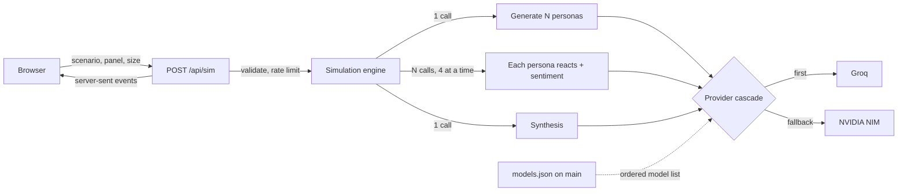

# Crowdmind

[](https://github.com/GerardoLucero/crowdmind/actions/workflows/ci.yml)
[](LICENSE)


**An AI focus group in under a minute.** Describe a CV, a startup pitch or product copy, pick who is in the panel (investors, hiring managers, customers...) and see how a group of simulated people reacts: a consensus score, majority and minority views, recurring patterns, surprises and a concrete next step.

Personas are generated by a language model, so treat the output as a rehearsal for the real conversation, not as market research.

## Try it without any API key

The `/sim` page has a **precomputed example** that loads instantly and calls no model, so you can see what a result looks like before configuring anything.

## Run it

```bash
git clone https://github.com/GerardoLucero/crowdmind
cd crowdmind
npm install
cp .env.example .env.local   # add GROQ_API_KEY and/or NVIDIA_NIM_API_KEY (both have free tiers)
npm run dev                  # http://localhost:3000/sim
npm test
```

| Variable | Required | Purpose |
|---|---|---|
| `GROQ_API_KEY` | one of the two | Primary provider ([console.groq.com](https://console.groq.com), free tier) |
| `NVIDIA_NIM_API_KEY` | one of the two | Fallback provider ([build.nvidia.com](https://build.nvidia.com), free credits) |
| `GROQ_MODEL` / `NVIDIA_MODEL` | no | Emergency model override |
| `MODEL_CONFIG_URL` | no | URL of `models.json`, or `off` to use only the bundled copy |

Deploy on Vercel with the same two variables. There is no database: the server is stateless and the history of recent runs lives in the browser.

## How it works



1. **Panel.** One call generates N distinct personas for the chosen profile.
2. **Reactions.** One call per persona returns the reaction, its sentiment and key points. They run four at a time to stay inside free-tier token limits, and each result streams to the page as it arrives.
3. **Synthesis.** Sentiment numbers are computed in code (a mixed reaction counts as half a positive); one more call writes the consensus, dissent, patterns, surprises and recommendation.

### Design decisions

- **Stateless.** Nothing is stored server side, so it deploys on Vercel's free tier and there is nothing to leak.
- **Free providers with a cascade.** Groq first, NVIDIA NIM as fallback; if a model is retired (HTTP 404/410) the next one in `models.json` is tried. Edit `models.json` on `main` to change models without a deploy.
- **Untrusted text is fenced.** The scenario goes inside tags, look-alike tags are stripped, and model output is validated with zod. Provider errors never reach the client.
- **Honest failure.** If every persona fails the user gets a clear message; if only the synthesis fails the page says so and still shows the reactions.
- **Bounded cost.** Scenario capped at 4,000 characters, 3 to 12 personas, 6 runs per 30 minutes per IP (best effort, per instance).

## API

The same engine is available to scripts and agents. Pass `"stream": false` to get one JSON document instead of an event stream.

```bash
curl -X POST http://localhost:3000/api/sim \
  -H "Content-Type: application/json" \
  -d '{"scenario":"Senior backend engineer, 9 years in payments...","n":8,"profileType":"hiring-managers","stream":false}'
```

Profiles: `hiring-managers`, `tech-leads`, `ctors`, `recruiters`, `peers`, `investors`, `customers`, or a custom `profileConfig` with `role`, `experience`, `industry` and `bias`. `GET /api/health` reports whether a provider is configured, without calling any model.

## Quality

- Unit tests (Vitest) for the engine, provider cascade, sanitizing and model config; type check and production build on every PR.
- A scheduled workflow probes every model in `models.json` daily and sends a push notification if one stops answering.
- Dependabot for npm and GitHub Actions; `npm audit` clean. See [SECURITY.md](SECURITY.md).

## Support

Open source, maintained in my spare time. If it was useful and you want to say thanks:

[](https://ko-fi.com/gerardolucero)
[](https://buymeacoffee.com/lucerorios0)

## License

MIT, see [LICENSE](LICENSE).
